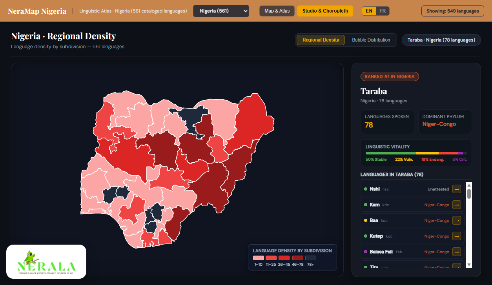
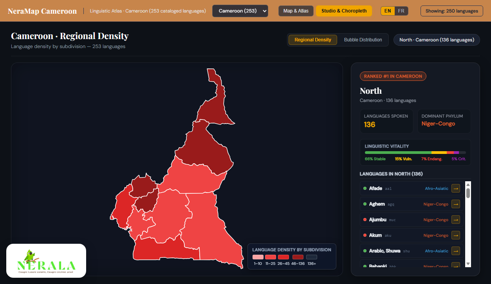
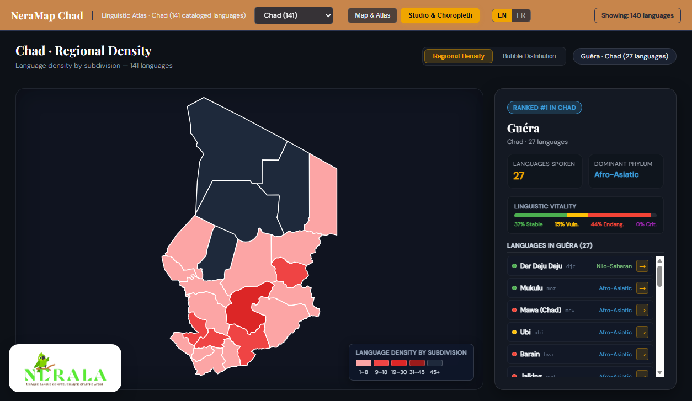
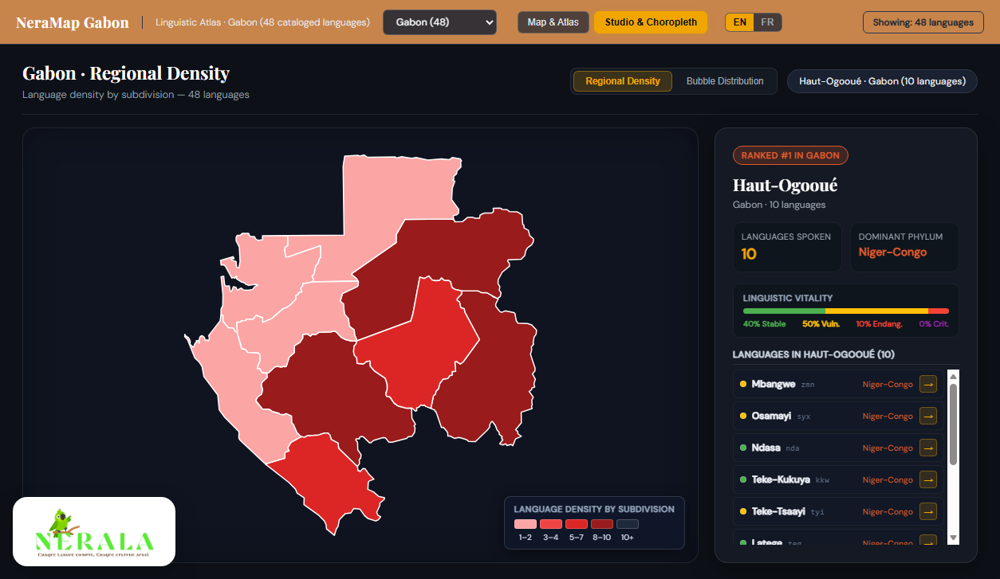
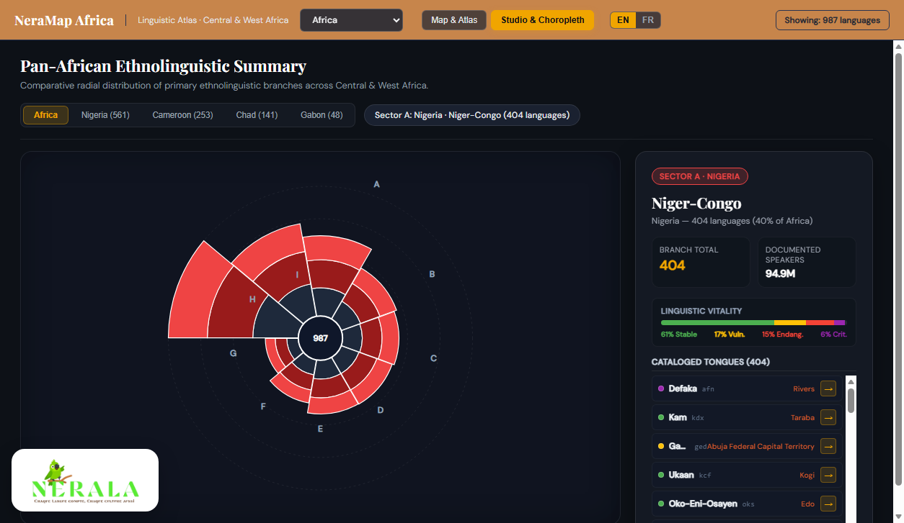
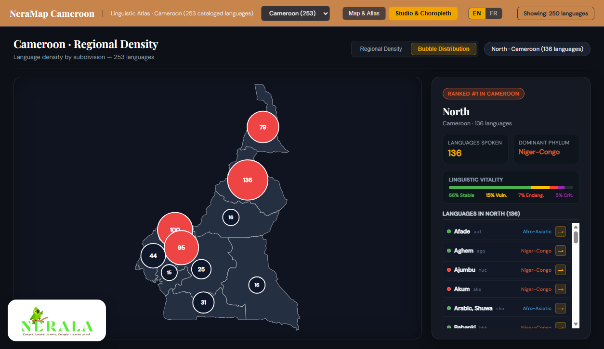
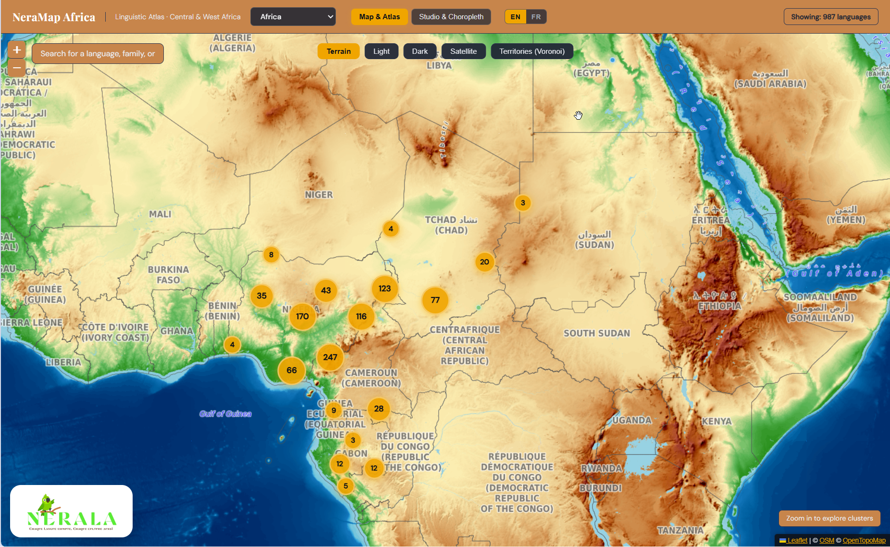

# NeraMap

> **Interactive Linguistic Atlas & Regional Studio for Central & West Africa**  
> An open, high-performance web platform documenting 987+ living languages across Nigeria, Cameroon, Chad, and Gabon.

---

## Visual Showcase

### 1. Country-Level Regional Choropleth Maps
When a country is selected, NeraMap renders a high-precision vector choropleth map across its first-order administrative subdivisions, classified by linguistic density with crisp borders, a dynamic legend, and an interactive region sidebar.

| **Nigeria (37 States · 561 Languages)** | **Cameroon (10 Regions · 253 Languages)** |
|:---:|:---:|
|  |  |

| **Chad (23 Provinces · 141 Languages)** | **Gabon (9 Provinces · 48 Languages)** |
|:---:|:---:|
|  |  |

---

### 2. Pan-African Summary & Proportional Bubble Maps

| **Pan-African Summary (Nightingale Rose Chart)** | **Proportional Bubble Distribution Map** |
|:---:|:---:|
|  |  |
| *Radial polar area chart summarizing the 9 primary ethnolinguistic branches of Central & West Africa, nested by language vitality.* | *Proportional centroid circles scaled to language frequency per subdivision, highlighted by diversity tier.* |
---

### 3. Interactive Map & Atlas
| **Continental Clustered Language Atlas** |
|:---:|
|  |
| *Multi-basemap geographic canvas with cluster navigation, multi-source filtering, and individual language inspection.* |

---

## Key Features

- **Territorial Geographic Accuracy**:
  - Over 987 cataloged languages snapped strictly within national administrative boundaries (`geoBoundaries ADM1`), eliminating transboundary coordinate bleeding.
  - Multi-country selector supporting Nigeria (`NG`), Cameroon (`CM`), Chad (`TD`), Gabon (`GA`), and Africa (`ALL`).

- **Interactive Region & Language Sidebar**:
  - Regional statistics: National rank, cataloged languages, dominant phylum, and estimated speaker count.
  - Linguistic vitality breakdown: Real-time proportional bar showing % Stable, % Vulnerable, % Endangered, and % Critical.
  

- **Multi-Basemap & High-Res Tile Caching**:
  - Switch between **Dark** (CARTO API integration), **Light** (OpenStreetMap), **Terrain** (OpenTopoMap), and **Satellite** (Esri World Imagery).
  - Built-in Service Worker caching map tiles for fast and offline-ready reloads.

---

## Project Structure

```text
neramap/
├── index.html                 # Main single-page application entry point
├── style.css                  # UI design system, layout, and choropleth styles
├── sw.js                      # Service Worker for tile caching
├── data/
│   ├── geo-regions.js         # Simplified ADM1 boundaries & centroids (RFC 7946 compliant)
│   ├── languages/
│   │   ├── CM.js              # Cameroon language dataset (253 languages)
│   │   ├── NG.js              # Nigeria language dataset (561 languages)
│   │   ├── TD.js              # Chad language dataset (141 languages)
│   │   └── GA.js              # Gabon language dataset (48 languages)
│   └── sources/               # Raw geoBoundaries and Glottolog sources
├── js/
│   ├── config.js              # Map basemap layers, API keys & constants
│   ├── i18n.js                # Bilingual localization engine (EN / FR)
│   ├── data.js                # Language data normalization & store
│   ├── country-filter.js      # Multi-country selector & viewport scope
│   ├── map-init.js            # Leaflet map initialization & basemap control
│   ├── markers.js             # Marker clustering & custom pin rendering
│   ├── panel.js               # Language detail side-panel
│   ├── search-filters.js      # Query search & taxonomic family toggles
│   ├── viz-studio.js          # Studio mode controller (Map vs Studio)
│   ├── viz-sunburst.js        # D3 Choropleth, Bubble Map & Rose Summary engine
│   └── main.js                # App orchestration & bootstrapper
└── reports/                   # Automated headless visual test renders
```

---

## Getting Started

NeraMap is a zero-dependency static web application and requires no build tools.

### 1. Clone the Repository
```bash
git clone https://github.com/nerala/neramap.git
cd neramap
```

### 2. Start a Local Server
Run any local static file server:

**Using Python:**
```bash
python -m http.server 8085
```

**Using Node.js:**
```bash
npx serve -l 8085
```

### 3. Open in Browser
Visit [http://localhost:8085/](http://localhost:8085/) in your browser.

---

## Scientific Data Sources

- **[Glottolog](https://glottolog.org/)** — Comprehensive bibliographic and genealogical catalog of the world's languages.
- **[WALS (World Atlas of Language Structures)](https://wals.info/)** — Large database of structural properties of languages.
- **[ALCAM](https://cerdotola.org/)** — Atlas Linguistique du Cameroun (CERDOTOLA).
- **[geoBoundaries](https://www.geoboundaries.org/)** — Open-source global administrative subdivision boundary database.
- **[CARTO Basemaps](https://carto.com/basemaps/)** & **[OpenStreetMap](https://www.openstreetmap.org/)** — Cartographic base tiles.

---

## License

This project is licensed under the MIT License. See [LICENSE](LICENSE) for details.
